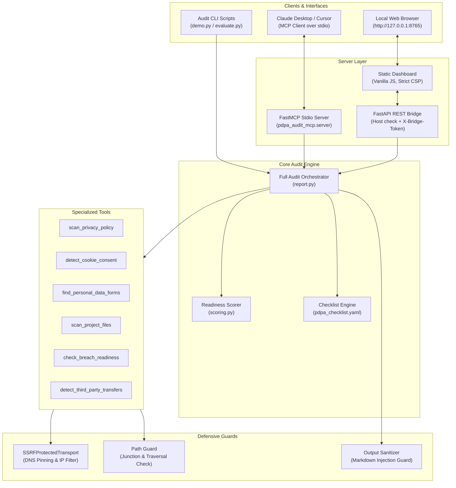

# Sri Lanka PDPA Technical Readiness Audit (MCP Server)

<p align="center">
  <a href="https://github.com/Sadeep78/pdpa-audit-mcp/releases"></a>
  <a href="LICENSE"></a>
  <a href="https://www.python.org/downloads/"></a>
  <a href="https://github.com/Sadeep78/pdpa-audit-mcp/actions"></a>
  <a href="https://modelcontextprotocol.io"></a>
  <a href="https://github.com/astral-sh/ruff"></a>
</p>

An open-source technical hygiene, readiness indicator, and gap analysis toolkit aligned with Sri Lanka's **Personal Data Protection Act, No. 9 of 2022 (PDPA)**.

`pdpa-audit-mcp` exposes 9 specialized tools through the **Model Context Protocol (MCP)** for AI coding assistants (such as Claude Desktop and Cursor), a local REST bridge, and a single-page interactive web dashboard.

---

> [!WARNING]
> **LEGAL DISCLAIMER**: This tool provides technical readiness indicators and gap analysis only. It does **NOT** constitute legal advice or formal certification of compliance with Sri Lanka's Personal Data Protection Act, No. 9 of 2022 (PDPA). Organizations must verify all legal references against the official gazetted Act at [dpa.gov.lk](https://dpa.gov.lk) and consult qualified legal counsel. Check [dpa.gov.lk](https://dpa.gov.lk) for current commencement notifications.

> [!IMPORTANT]
> **DEFENSIVE USE ONLY**: Use this tool only on websites, endpoints, or local repositories that you own or have explicit written authorization to audit. Never use this tool for port scanning, network exploitation, fuzzing, or credential brute-forcing.

---

## Table of Contents

- [Key Features](#key-features)
- [Architecture Overview](#architecture-overview)
- [Installation](#installation)
- [Quick Start](#quick-start)
  - [1. FastMCP Stdio Server (Claude Desktop)](#1-fastmcp-stdio-server-claude-desktop)
  - [2. Interactive Web Dashboard](#2-interactive-web-dashboard)
  - [3. Evaluation Sheet Generator CLI](#3-evaluation-sheet-generator-cli)
  - [4. Offline Demonstration](#4-offline-demonstration)
- [Claude Desktop Configuration](#claude-desktop-configuration)
- [Tool Reference](#tool-reference)
- [Scoring & Heuristic Evaluation](#scoring--heuristic-evaluation)
- [Safety & Security Architecture](#safety--security-architecture)
- [Validation & Empirical Evaluation](#validation--empirical-evaluation)
- [Limitations](#limitations)
- [Contributing](#contributing)
- [License](#license)

---

## Key Features

- **9 Specialized MCP Audit Tools**: Inspect privacy policies, cookie consent banners, personal data forms, source code schemas, breach readiness documentation, and cross-border vendor data flows.
- **Trilingual Indicator Detection**: Full text normalization and keyword indicator matching across **English**, **Sinhala** (සිංහල), and **Tamil** (தமிழ்).
- **Comprehensive SSRF & DNS Rebinding Immunity**: Socket-level IP address pinning disallows loopback, private RFC 1918, link-local, carrier-grade NAT, 6to4, NAT64, and cloud metadata (`169.254.169.254`) requests.
- **Strict Path Boundary Guard**: Enforces root containment against directory traversal (`..`), Windows UNC shares, alternate drive letters, and symlink/junction escapes outside configured directories.
- **Zero Personal Data Storage**: Audits structural attributes and parameter names only. Raw field values, passwords, form entries, and logging payloads are never recorded or emitted in reports.
- **Self-Contained Web Dashboard**: Modern vanilla HTML5/CSS3 interface running locally with zero external network requests, per-response Content Security Policy nonces, and zero vulnerable DOM sinks (`innerHTML`, `eval`).
- **Standardized Reporting**: Exports structured Markdown and JSON gap reports complete with prioritised findings, rule coverage metrics, and actionable remediation notes.

---

## Architecture Overview



---

## Installation

### Prerequisites

- **Python 3.11** or higher
- Recommended: [`uv`](https://docs.astral.sh/uv/) (extremely fast Python package and environment manager)

### Option 1: With `uv` (Recommended)

```bash
# Clone the repository
git clone https://github.com/Sadeep78/pdpa-audit-mcp.git
cd pdpa-audit-mcp

# Install dependencies and sync virtual environment
uv sync
```

### Option 2: With standard `pip` and virtualenv

```bash
# Clone the repository
git clone https://github.com/Sadeep78/pdpa-audit-mcp.git
cd pdpa-audit-mcp

# Create and activate virtual environment
python -m venv .venv

# Windows
.venv\Scripts\activate
# Linux / macOS
source .venv/bin/activate

# Install in editable mode
pip install -e .
```

---

## Quick Start

### 1. FastMCP Stdio Server (Claude Desktop)

Start the FastMCP stdio server directly:

```bash
# Using uv
uv run pdpa-audit-mcp

# Using virtualenv
pdpa-audit-mcp
```

### 2. Interactive Web Dashboard

Launch the local REST bridge and web UI:

```bash
# Using uv
uv run pdpa-audit-bridge

# Custom port
uv run pdpa-audit-bridge --port 8765
```

Open **`http://127.0.0.1:8765/`** in your browser to run audits and download Markdown gap analysis reports.

### 3. Evaluation Sheet Generator CLI

Generate a rule-by-rule human labeling sheet for an authorized target:

```bash
uv run python scripts/evaluate.py --url https://example.com --confirm-authorised --out docs/evaluation_sheet.md
```

### 4. Offline Demonstration

Run the automated offline demonstration against the bundled test fixtures:

```bash
uv run python scripts/demo.py
```

This spins up local test servers, executes the full audit against compliant and non-conforming fixtures, displays console tables with matched indicator terms, and writes example reports to `docs/examples/`.

---

## Claude Desktop Configuration

To connect `pdpa-audit-mcp` to **Claude Desktop**, add the server to your `claude_desktop_config.json`:

- **Windows**: `%APPDATA%\Claude\claude_desktop_config.json`
- **macOS**: `~/Library/Application Support/Claude/claude_desktop_config.json`

```json
{
  "mcpServers": {
    "pdpa-audit": {
      "command": "uv",
      "args": [
        "run",
        "--directory",
        "C:\\path\\to\\pdpa-audit-mcp",
        "pdpa-audit-mcp"
      ],
      "env": {
        "PDPA_AUDIT_ALLOWED_ROOTS": "C:\\path\\to\\your\\projects",
        "PDPA_AUDIT_ALLOW_PRIVATE": "false"
      }
    }
  }
}
```

### Environment Configuration Variables

| Variable | Default | Purpose |
|---|---|---|
| `PDPA_AUDIT_ALLOWED_ROOTS` | Current directory | Semicolon-delimited (Windows) or colon-delimited (Linux/macOS) list of paths allowed for project file inspection. |
| `PDPA_AUDIT_ALLOW_PRIVATE` | `false` | Set to `true` **only** when auditing local development servers (`http://localhost:3000`, `127.0.0.1`). |
| `PDPA_AUDIT_TIMEOUT_SECONDS` | `10.0` | Per-request HTTP network timeout in seconds. |
| `PDPA_AUDIT_FETCH_DEADLINE_SECONDS` | `20.0` | Total deadline for full page fetch and redirect chains. |

---

## Tool Reference

All tools include the defensive use notice: *"Use only on sites/projects you own or are authorised to audit."*

| Tool | Target | Description |
|---|---|---|
| `scan_privacy_policy` | Web URL | Audits policy text for processing purposes, retention periods, categories collected, contact details, and data subject rights (access, correction, erasure, withdrawal of consent, objection). |
| `detect_cookie_consent` | Web URL | Identifies cookie banners, affirmative opt-in buttons, equal reject buttons, pre-consent tracking scripts, and cookie security flags (`Secure`, `HttpOnly`, `SameSite`). |
| `find_personal_data_forms` | URL or Local Path | Scans HTML forms for sensitive categories (NIC, passport, biometric, health), insecure GET submissions, pre-checked opt-in boxes, and password autocomplete attributes. |
| `scan_project_files` | Local Path | Analyzes database schemas, code-level erasure/retention logic (`erasure_mechanism_in_code`), hardcoded logging of personal data fields (`no_pii_in_logs`), and cloud SDK manifests. |
| `check_breach_readiness` | Local Path | Checks for documented incident response plans (`BREACH_RESPONSE.md`), security contact addresses (`security.txt`), and escalation timelines. |
| `detect_third_party_transfers` | Web URL | Audits external domain assets (CDNs, analytics, tracking pixels) and cross-border data transfer disclosures in privacy notices. |
| `run_full_audit` | URL and/or Path | Orchestrates all audit tools concurrently, isolates network errors, applies conservative merge precedence, and calculates readiness scores. |
| `generate_gap_report` | Audit Result | Formats raw audit findings into structured Markdown or JSON gap reports with executive summaries, categorised breakdowns, and remediation notes. |
| `list_checklist` | None | Lists bundled technical checklist rules, with optional category filtering. |

---

## Scoring & Heuristic Evaluation

Readiness scores are computed as a **weighted percentage (0.0% – 100.0%)** accompanied by explicit coverage metrics:

1. **Heuristic Weights**:
   - `high` severity: weight 3
   - `medium` severity: weight 2
   - `low` severity: weight 1
2. **Evaluated vs Excluded Rules**:
   - `passed`: earns 100% of rule weight.
   - `failed`: earns 0% of rule weight.
   - `needs_review` / `not_evaluated`: excluded from the scored denominator to prevent unassessed rules from skewing scores.
   - `not_applicable`: excluded from both score denominator and coverage numerator when target components are absent (e.g. no cookies set, no password fields, no external vendors).
3. **Anti-False-Confidence Safeguards**:
   - Scores always display coverage side-by-side (e.g., `100.0% (Mostly Ready | Coverage: 95.8%)`).
   - If weight coverage is under 60%, the label is automatically suffixed with `(partial assessment)`.
   - If no evaluable rules run, scores return `None` with label **"Insufficient data"**, never an inaccurate 0% or 100%.
4. **Multi-Source Merge Precedence**:
   When multiple tools assess the same rule, findings are merged using a strict conservative hierarchy:
   $$\text{failed} > \text{needs\_review} > \text{passed} > \text{not\_evaluated} > \text{not\_applicable}$$

---

## Safety & Security Architecture

- **SSRF Defense**: The custom `SSRFProtectedTransport` resolves hostnames and executes DNS pinning before initiating the first network hop, preventing DNS rebinding.
- **Decompression Bomb Guard**: Streams decompressed HTTP responses with an enforced 1 MB threshold.
- **Path Traversal Protection**: Strictly blocks `..` path segments, Windows UNC shares (`\\host\share`), alternate drive prefixes, and directory junctions pointing outside allowed paths.
- **Privacy Assurance**: Logging findings report `file:line` locations only. Log payloads and personal values are never extracted or stored.
- **Content Security Policy**: Dashboard uses a strict CSP with per-request cryptographic nonces, blocking unsafe inline scripts and cross-origin connections.

---

## Validation & Empirical Evaluation

The automated test suite in `tests/test_rule_matrix.py` is a **synthetic regression harness** verifying keyword indicators, multilingual normalization (English, Sinhala, Tamil), and structural detectors.

Real-world precision, recall, and false-positive rates are measured through manual verification against production targets documented in [`docs/EVALUATION.md`](docs/EVALUATION.md).

---

## Limitations

1. **Static HTML Only**: Scans static HTML responses only; single-page applications (SPAs) that render dynamically via client-side JavaScript without server-side rendering will show little content and may omit unrendered elements.
2. **Keyword Heuristics**: Textual analysis relies on normalized keyword indicators across English, Sinhala, and Tamil. Complex legal drafting nuances require human expert verification.
3. **No Proof of Runtime Behaviour**: Static analysis does not monitor runtime network egress, live database write operations, or actual backend retention cron jobs.
4. **Chunk-Level Decompression**: Response decompression is capped at 1 MB after each chunk is received. While payloads exceeding 1 MB are truncated safely, an extreme compression ratio within a single chunk can cause a brief memory spike before truncation.
5. **CDN & Font Domains**: External CDN and web font domains are reported as third-party processors with unverified locations, which may produce false fails for cross-border transfer disclosures when such assets do not process personal data.

---

## Contributing

Contributions are welcome! Please follow these steps:

1. Fork the repository.
2. Create a feature branch: `git checkout -b feature/my-feature`.
3. Ensure formatting and tests pass:
   ```bash
   uv run ruff check .
   uv run ruff format .
   uv run pytest -W error::ResourceWarning
   ```
4. Commit your changes and open a Pull Request.

---

## License

This project is open-source software licensed under the **[MIT License](LICENSE)**:

```text
Copyright (c) 2026 Sadeep Sasanka (Sadeep78) and pdpa-audit-mcp contributors

Permission is hereby granted, free of charge, to any person obtaining a copy
of this software and associated documentation files (the "Software"), to deal
in the Software without restriction, including without limitation the rights
to use, copy, modify, merge, publish, distribute, sublicense, and/or sell
copies of the Software, and to permit persons to whom the Software is
furnished to do so, subject to the following conditions:
...
```

For full license details, see the [`LICENSE`](LICENSE) file.
