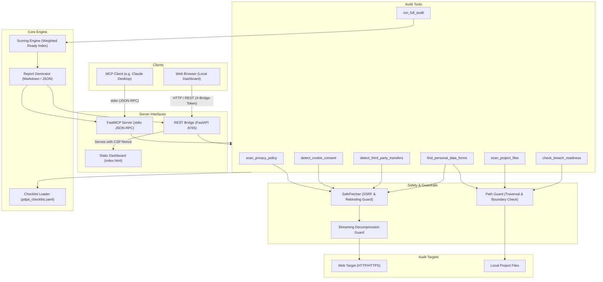

# Architecture Overview

`pdpa-audit-mcp` is an open-source technical readiness audit system designed to evaluate websites and local software repositories against technical indicators derived from Sri Lanka's Personal Data Protection Act, No. 9 of 2022 (PDPA).

> [!NOTE]
> This tool provides technical readiness indicators and gap analysis only. It does NOT constitute legal advice or formal compliance certification. All legal references must be verified against the official Act (dpa.gov.lk).

---

## 1. System Architecture

The following diagram illustrates the relationship between the MCP client (such as Claude Desktop), the stdio FastMCP server, the REST bridge, the web dashboard, the audit tools, security guards, checklist rules, and reporting engine:

---

## 2. Component Details

### A. Server Interfaces
- **FastMCP Stdio Server (`server.py`)**: Runs as a lightweight subprocess communicating over standard input/output (`stdio`) via JSON-RPC. All logging is routed to `sys.stderr` to maintain clean protocol serialization.
- **REST Bridge (`api/bridge.py`)**: A local FastAPI server binding to `127.0.0.1:8765`. It exposes REST endpoints for all audit capabilities and serves the dashboard. It implements Host header allowlists, per-run token authentication (`X-Bridge-Token`), body size caps (64 KB), and an `asyncio.Lock` preventing overlapping audits.
- **Web Dashboard (`dashboard/index.html`)**: A single-page application built entirely with vanilla JavaScript and CSS. It makes zero external network requests and renders all untrusted audit findings via safe DOM text APIs (`document.createTextNode` and `.textContent`).

### B. Safety & Security Layer (`safety.py` & `fetcher.py`)
- **SSRF & DNS Rebinding Protection**: Validates URLs, rejecting non-HTTP/HTTPS schemes, credentials in userinfo, non-canonical IP encodings (octal/hex/decimal), loopback, link-local, private RFC 1918, CGNAT, 6to4, NAT64, and cloud metadata addresses (`169.254.169.254`). Uses `SSRFProtectedTransport` to pin the pre-resolved IP on the first hop, preventing time-of-check to time-of-use (TOCTOU) DNS rebinding attacks.
- **Path Guard**: Canonicalizes filesystem paths using `Path.resolve()`, enforcing that audited directories reside within `PDPA_AUDIT_ALLOWED_ROOTS` (defaulting to the working directory). Blocks UNC network shares, directory traversal (`..`), drive switching, and symlink/junction escapes.
- **Resource & Timeout Controls**: Streams responses in 64 KB chunks up to 1 MB decompressed. Wraps each request and redirect sequence in an overall timeout deadline (default 20.0s).

### C. Rule Engine & Scoring (`checklist.py` & `scoring.py`)
- **Checklist**: Bundled in `pdpa_checklist.yaml`, mapping technical indicator rules across 6 core categories (Transparency, Data Minimisation, Purpose Limitation, Retention, Security Safeguards, and Data Subject Rights).
- **Detectors & Matchers**: Uses structural detectors for programmatic indicators (HTTPS enforcement, form methods, cookie flags, autocomplete attributes) and normalized multilingual keyword matching (English, Sinhala, Tamil) on word boundaries for text rules.
- **Scoring**: Computes category and overall readiness scores from heuristic weights. Excludes rules marked `needs_review` and `not_evaluated` from the score denominator. If no rules are evaluable, returns `None` ("Insufficient data") instead of a misleading zero or 100.
